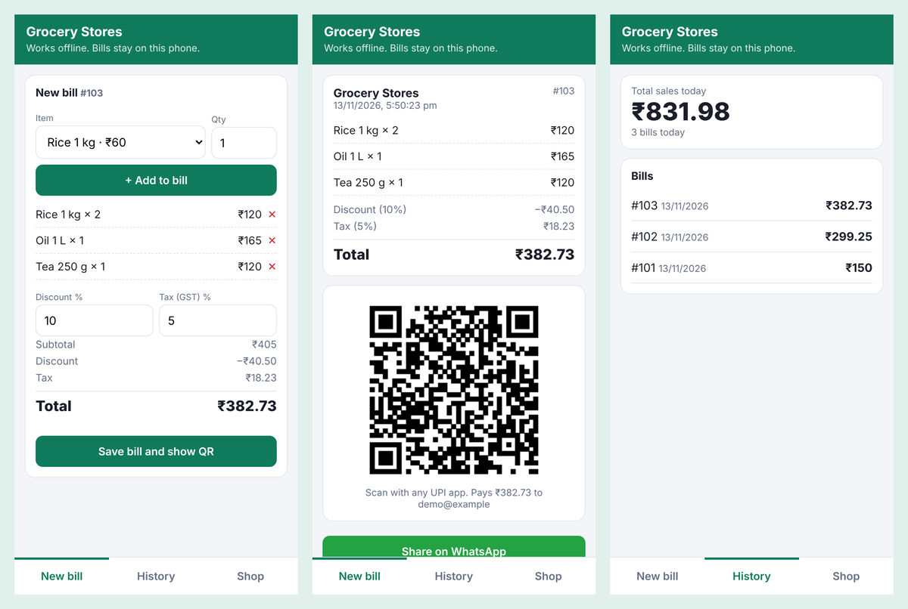

# 🧾 Bill Book

A tiny billing app for a small shop. Make a bill, show a **UPI QR code for the exact amount**, and share the bill as a picture. It runs in the browser, works **offline**, and keeps everything on your own phone. No login, no server, no cost.

<div align="center">

</div>

> The shop name and UPI ID in the screenshot are sample values.

## ✨ Features

- 🛒 **Quick bills:** pick an item, enter a quantity (decimals work, like 0.5 kg), add more items
- 🏷️ **Discount and tax:** a percentage for each, with the subtotal, discount, tax and total updating live
- 📲 **UPI QR code:** a scannable QR for the exact bill amount, sent to your UPI ID
- 🖼️ **Share a bill:** sends a picture of the bill (with the QR inside it) through your phone's share menu, or saves the picture and opens WhatsApp
- 📚 **History:** every bill is saved, tap one to open it again, and see today's total sales
- 🧰 **Your own items:** add or remove items and prices in the Shop tab
- ✈️ **Works offline:** after the first visit it runs in flight mode, and you can install it on your home screen
- 🔢 **Accurate money:** amounts are kept in whole paise, so totals never drift by a rupee

## 🚀 How to use

1. Open the app (see below).
2. Go to the **Shop** tab. Type your shop name and **your own UPI ID** (like `name@bank`). The app won't save a bill until a valid UPI ID is set.
3. Add your items and prices.
4. On **New bill**, add items, set discount and tax if needed, then press **Save bill and show QR**.
5. The customer scans the QR with any UPI app. Use **Share on WhatsApp** to send the bill.

### Open it

- **On a computer:** open `index.html` in Chrome.
- **On a phone, installed:** host the folder with GitHub Pages (below), open the link on your phone, then use **Add to Home screen** in the browser menu.


## 🔍 How the QR code works

The app builds a payment link from your UPI ID, shop name and the bill total:

```
upi://pay?pa=name%40bank&pn=Grocery%20Stores&am=382.73&cu=INR&tn=Bill%20103
```

A small library turns that text into a grid of black and white squares, and the app draws it on a canvas. This all happens on your phone, so it works with no internet. A UPI app that scans it opens a payment screen with the amount already filled in.

## ⚠️ Good to know

- **The app can't tell whether the customer paid.** The QR only opens a payment screen. Check your UPI app for the money.
- **Bills live only in this browser on this phone.** Clearing the site's data, or switching phones, loses them. There is no backup or export yet.
- **Bills can't be edited or deleted after saving.**
- **This is not a tax invoice.** The tax field is one flat percentage for the whole bill, with no GSTIN or official invoice layout.
- Items can be added or removed, but not edited. To change a price, delete the item and add it again.

## 🧱 Built with

Plain **HTML, CSS and JavaScript**, with no build step and no framework. It's an installable web app (PWA), made of a web app manifest and a service worker that caches the files for offline use.

## 📂 Files

| File | What it is |
|---|---|
| `index.html` | The whole app: page, styles and script |
| `manifest.webmanifest` | Lets the app be installed to a home screen |
| `sw.js` | Service worker that caches the app for offline use |
| `icon-192.png`, `icon-512.png` | App icons |
| `qrcode.js` | Third-party QR code library (see below) |
| `LICENSE` | License for this project's own code |
| `THIRD-PARTY-NOTICES.md` | License notice for `qrcode.js` |

## 📜 License and credits

This project's own code is released under the [MIT License](LICENSE).

QR codes are generated by **[qrcode-generator](https://github.com/kazuhikoarase/qrcode-generator)** by Kazuhiko Arase, used under the MIT License. See [THIRD-PARTY-NOTICES.md](THIRD-PARTY-NOTICES.md). "QR Code" is a registered trademark of DENSO WAVE INCORPORATED.
